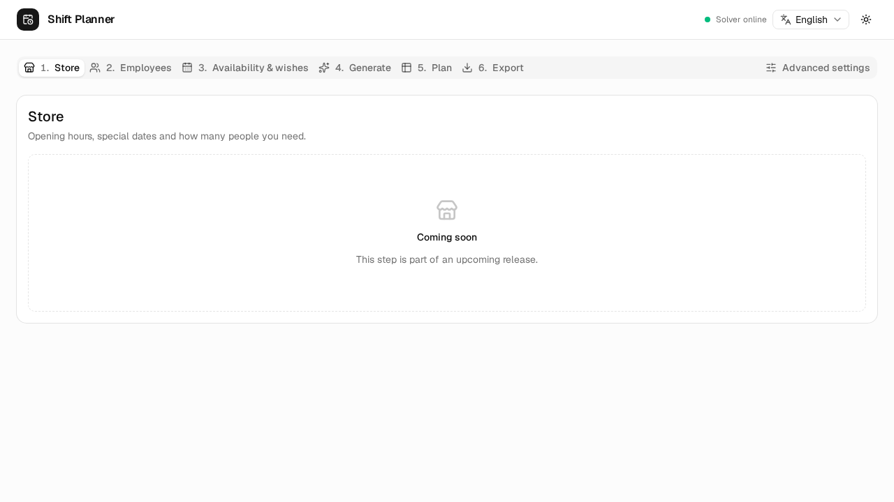
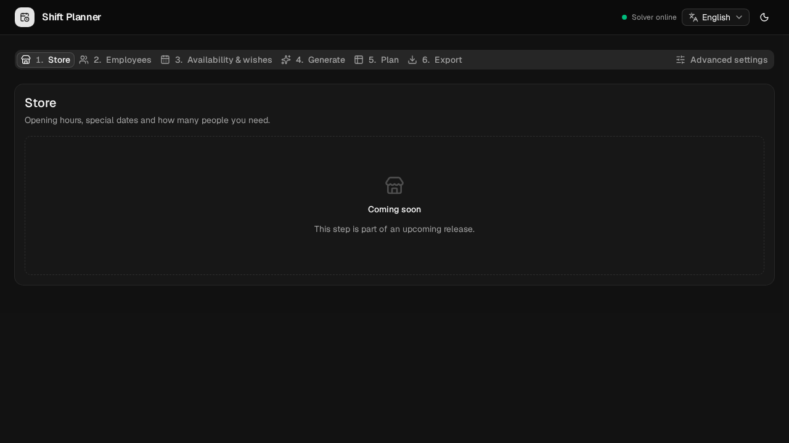

# Shift Planner

[](https://github.com/jeney/shift-planner/actions/workflows/ci.yml)
[](LICENSE)

A shift-planning web app for a single store manager with a small team. Enter opening hours,
staffing needs, employees and their availability. The app generates an optimal monthly plan
with Google OR-Tools CP-SAT, and you can fine-tune it by hand with live rule checking.

- **No accounts, no database.** The browser owns all data (autosave + save/open as `.json`).
- **English, Danish and Hungarian.**
- Simple by default. Every rule and weight is available under *Advanced settings*.

> 🚧 Early development. See the [roadmap](#roadmap). [How it works](#how-it-works) describes the target behaviour.

| Light | Dark |
|---|---|
|  |  |

## Quick start

You need Docker with Docker Compose.

```bash
docker compose up --build
```

Then open <http://localhost:8080>. Set `FRONTEND_PORT=9000` to use another port.

### Development (hot reload)

```bash
docker compose -f compose.yaml -f compose.dev.yaml up --build
```

| What | URL |
|---|---|
| Frontend (Vite) | <http://localhost:5173> |
| Backend API docs | <http://localhost:8000/api/docs> |

### Without Docker

Requirements: [uv](https://docs.astral.sh/uv/) and Node.js 22.

```bash
# Terminal 1: backend
cd backend
uv sync
uv run uvicorn shift_planner.main:app --reload

# Terminal 2: frontend (proxies /api to localhost:8000)
cd frontend
npm ci
npm run dev
```

## How it works

One manager plans **one calendar month** for a small team (about 8–10 people: full-timers ~40 h/week,
part-timers ~20 h/week, student workers ~10 h/week). All times are local (Europe/Copenhagen), and weeks start
on Monday.

The flow has six steps, which you can visit in any order:

1. **Store:** opening hours, special dates, staffing needs.
2. **Employees:** contracts, car/ride flags, hour balances carried in from earlier months.
3. **Availability & wishes:** hard unavailability and soft wishes per employee.
4. **Generate:** the solver builds the best plan it can and explains any problems.
5. **Plan:** an editable grid (people × days) with live rule checking, undo/redo and "re-generate, keeping my edits".
6. **Export:** PDF/print and LibreOffice/Excel spreadsheets (`.ods`, `.xlsx`).

**Advanced settings** exposes every rule and weight, each with a short help text. You never *need* it: the
defaults are meant to produce a good plan.

### Store defaults

The defaults match the store this app was built for:

| Days | Store open | Staff present |
|---|---|---|
| Monday, Friday | 07:00–20:00 | 06:00–20:30 |
| Tuesday–Thursday, Saturday, Sunday | 07:00–18:00 | 06:00–18:30 |
| Public holidays | 07:00–18:00 | 06:00–18:30 |

- The store is open every day of the year.
- Staff work **60 min before opening** and **30 min after closing**. Both values are configurable.
- Public holidays have their own opening-hours setting, so a holiday on a Monday doesn't inherit Monday's hours.
- **Danish public holidays are preloaded.** Christmas Eve, New Year's Eve and Constitution Day are preloaded as
  *notable days*. Their special opening hours are **off by default**. Enable a date to give it custom hours (e.g. close an hour early)
  or close the store that day.
- **Staffing needs:**
  - At least 1 person at opening and 1 at closing, configurable per day type (weekday, Saturday, Sunday, public holiday).
  - Nobody works alone unless *Allow someone to work alone* is on.
  - Optional time-range minimums, e.g. "≥ 2 people 11:00–14:00 on Saturdays".
  - Optional daily total-hours targets per day type.
- **Guest-based demand** (optional, off by default): enter the expected guests per day. A table of points such as
  1000 → 20 h, 1250 → 25 h, 1500 → 30 h converts guests into that day's total staff hours, with linear
  interpolation or step tiers.

### Employees and hour balances

- **Monthly target = weekly contract hours × conversion factor.** The factor is a global setting:
  `52/12 ≈ 4.33` (default), `4.4`, or *actual weekdays in the month* (Mon–Fri days ÷ 5).
  - Public holidays **don't** reduce the target by default, because the store is open on them. A toggle changes this.
  - A team-level adjustment (± hours) can shift the whole team's total for a month.
- **The app doesn't remember past months.** For each employee you enter a **carry-in balance**, e.g. +3.5 h, and the
  **current week in the balancing period**, e.g. week 6 of 16. Optionally, you also enter when their last shift ended
  and how many days in a row they had worked at month start, so rest and consecutive-day rules hold on the 1st.
- **Balancing period:** 16 weeks by default (Danish retail collective agreement); 13/26/52 or custom also work.
  The solver steers each person so that `carry-in + (planned − target)` moves toward 0, and pushes harder near
  the end of the period.
- **Car and ride flags:** each employee can be marked as having a car and/or needing a ride on early shifts. See the bus/car rule below.

### Availability and wishes

- **Unavailable (hard):** the solver never schedules over these.
- **Wish (soft):** the solver tries to honour these, with no limit on how many. A wish can be "rather not work" or "would like to work".

Each entry is either:
- **recurring weekly**, e.g. "Mondays after 16:00"
- **one date**, the whole day or a time window
- **a date range**, e.g. a vacation

### Rules

| Rule | Default | Kind |
|---|---|---|
| Time grid for generated shifts | 30 min (15/30/60) | — |
| Shift length | 3–8 h | hard |
| Max hours per day | = max shift length. Applies to the **total** of all shifts that day | hard |
| Max one shift per day | on | hard |
| Minimum rest between shifts | 11 h | hard |
| Max consecutive working days | 6 (Danish law: ≤ 6 days between days off) | hard |
| Max weekly hours | 48 (warning above 37 for full-timers) | hard / warning |
| Monthly hours vs target | ± 2 h per employee | soft (an optional hard outer limit) |
| Breaks | off. When on: rules like "shift > X h ⇒ Y min break" and a **paid** toggle. Unpaid breaks don't count as worked hours | — |
| Bus/car rule | on | hard |

Every rule above is configurable, and most limits can also be overridden per employee.

- **Bus/car rule:** some people can't get to work by public transport before a certain time.
  - Each day type has an *early-start cutoff* (weekday 06:30, Saturday 07:30, Sunday/holiday 08:30).
  - If an employee who needs a ride starts **before** the cutoff, someone allowed to drive them (anyone with a car
    by default) must start at **exactly the same time**.
  - A matching *late-end* rule for evenings without buses exists, off by default.
- **Generated shift times are suggestions** on the time grid. Hand edits in the plan can use any minute.
- **Weeks that cross a month boundary:** only the shifts inside this month count toward that week's limit, because the
  neighbouring month's shifts aren't known.
- There is deliberately **no fairness balancing** of weekends, openings or closings.

### The solver

The backend is stateless: each request carries the whole project. It models the month as time slots with
[Google OR-Tools CP-SAT](https://developers.google.com/optimization/cp/cp_solver). Its objective minimises, in
rough priority order:

1. broken wishes
2. distance from each person's hour-balance goal
3. distance from daily hour targets
4. small tie-breakers, such as preferring days off together

If the rules can't all be met, you get both:

- **Diagnostics:** plain-language explanations, e.g. "Sat 14 Feb: opening needs 2 people but only 1 is available".
- **A best-effort plan:** every broken rule is listed and highlighted in red in the grid.

### Your data

- No accounts and no server-side storage.
- The project autosaves in your browser (`localStorage`). *Save project / Open project* uses a versioned `.json` file,
  and older files are migrated automatically.
- Demo data is fictional.

## Project layout

```
backend/    FastAPI + Pydantic v2 + OR-Tools CP-SAT (stateless; every request carries the full project)
frontend/   React + Vite + TypeScript, Tailwind CSS + shadcn/ui, react-i18next, TanStack Query
scripts/    Helper scripts (e.g. regenerating API types)
compose.yaml       Production-like stack: nginx serves the frontend and proxies /api to the backend
compose.dev.yaml   Development overrides with hot reload
```

### API types

The Pydantic models are the canonical schema. The frontend's TypeScript types are generated from
the OpenAPI spec, and CI fails if they're out of date:

```bash
./scripts/gen-api.sh
```

## Checks

| | Backend (`cd backend`) | Frontend (`cd frontend`) |
|---|---|---|
| Lint | `uv run ruff check .` | `npm run lint` |
| Format | `uv run ruff format .` | `npm run format` |
| Types | `uv run mypy src tests` | `npm run typecheck` |
| Tests | `uv run pytest` | `npm test` |
| E2E | | `npm run e2e` (or `E2E_BASE_URL=http://localhost:8080 npm run e2e` against Docker) |

CI runs all of these on every pull request, along with a Docker build and an e2e smoke test against the
production-like stack.

## Contributing workflow

- `main` only changes through pull requests.
- Use branches named `feat/…`, `fix/…` or `chore/…`, with [Conventional Commits](https://www.conventionalcommits.org/).
- PRs are squash-merged once CI is green.
- Never commit real employee data. Demo data is fictional.

## Roadmap

0. ✅ Scaffold: repo, Docker, CI, health endpoint, app shell with language switcher
1. Schema: project model, generated TS types, save/open, autosave, demo project
2. Setup UI: Store, Employees, Availability & wishes, Advanced settings
3. Solver core: hard constraints, coverage, `/api/solve`
4. Objective: wishes, hour-balance steering, daily targets
5. Diagnostics and best-effort plans with violation reporting
6. Plan grid: editing, live validation, undo/redo, pin & re-generate
7. Export: PDF/print, ODS/XLSX
8. Guest-based demand (optional feature)
9. Polish: design pass, translations review, e2e tests, docs

## License

[MIT](LICENSE)
